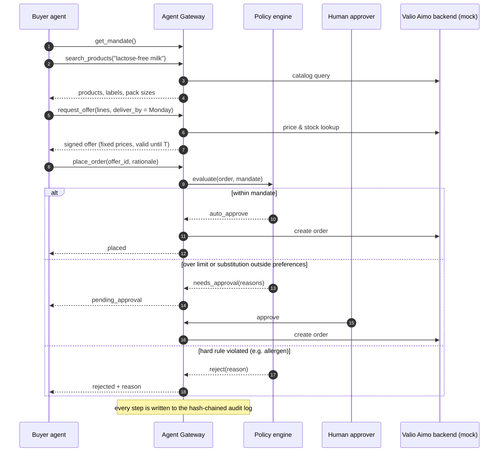

# Aimo Agent Gateway *(working title)*

> **Junction 2026 · Valio Aimo challenge.** Our goal is to let autonomous purchasing agents find products, compare offers and place orders with a food-service wholesaler in minutes, while keeping real systems, confidential data and humans' authority protected.

📋 **Progress tracker: [PLAN.md](PLAN.md)** · 🔌 **API notes: [docs/mock-api-notes.md](docs/mock-api-notes.md)**

## Run the MVP locally

```bash
pip install -r requirements.txt
cp .env.example .env               # Windows: copy .env.example .env, then add the Valio API key (team chat)
python scripts/download_data.py    # ~90 MB of challenge data into data/valio/ (git-ignored)
python -m uvicorn gateway.app:app --reload --port 8000
```

Open <http://127.0.0.1:8000>. The API docs are at <http://127.0.0.1:8000/docs>. The first start builds a slim catalog index, which takes a few seconds.

The site opens on a buyer-focused landing page. Buyers sign in there; Valio Aimo staff can open the separate admin sign-in from the header. Locally, with no `BUYER_PASSWORD` / `VALIO_PASSWORD` in `.env`, signing in needs no password.

| Portal | Page | What it shows |
|---|---|---|
| Buyer | **Order** | Type a need in plain words (English or basic Finnish). The agent shows what it understood (you can edit it), the steps it ran, ranked options per item with live prices and stock, and the decision: placed automatically, sent to Valio Aimo for approval, or blocked |
| Buyer | **My orders** | Your orders and what happened to each: placed automatically, waiting for Valio Aimo, or decided by a named person |
| Valio Aimo | **Review queue** | Orders that need a person, each with the reasons, the order lines, the request and the agent's rationale. Approving can also verify a new customer |
| Valio Aimo | **Customers** | The whitelist: trust status, Y-tunnus checksum, auto-approval limit and hard allergen rules. You can register a new customer |
| Valio Aimo | **Audit trail** | Every step by the customer, agent, policy and people, in plain language and hash-chained |
| Both | **Explore** | Catalog explorer with label/diet filters and a carbon-footprint-by-product-group chart that you can click to filter |

Sign in as a buyer and use the example buttons on the Order page for the demo scenarios.

**Deploying** to a Verda CPU instance takes one script: see [deploy/README.md](deploy/README.md).

---

## The problem

Today, professional kitchens order from Valio Aimo by logging into a webshop and clicking through a catalog. Soon the buyer's own AI agent will do that work. It will find products, compare them, order them and handle exceptions on the buyer's behalf.

For that to work, Valio Aimo needs an interface that an external agent can use to:

1. **Look up** products, prices and availability in a structured way.
2. **Move from inquiry to a firm order** at fixed prices, with no negotiation.
3. **Stay inside its authority.** The agent decides some things on its own, and the rest goes to a human for sign-off.

All of this must work without exposing internal systems, confidential data or the marketplace roadmap. It should also be built on open, verifiable standards, so that the interface is not defined by someone else's platform.

## Our approach

We build a **gateway** between external purchasing agents and Valio Aimo's backend (the challenge provides a mock of it). Agents never talk to the backend directly. They only use a small interface that is documented and that they can verify.

| # | Idea | What it gives |
|---|------|---------------|
| 1 | **One agent interface, two transports.** The same set of tools is offered as an **MCP server** (for LLM agents) and as **REST/OpenAPI** (for any other client). | Open standards, no lock-in to one platform |
| 2 | **Signed offers that expire** *(trust protocol)*. Every price and availability answer is an offer with an `offer_id`, a validity window, its data source and timestamp, and a gateway signature (Ed25519). An order points to an offer. | An agent can check claims without a manual step, and prices are fixed |
| 3 | **Mandates and a policy engine** *(guardrails)*. The buyer organisation gives each agent a mandate a machine can read: spend limits, allowed categories, required labels, allergen rules and how far substitutes may differ. Each order is checked against it and gets one of three results: `auto_approve`, `needs_approval` (with reasons) or `reject`. | Clear lines between what the agent decides alone and what a human signs off |
| 4 | **An audit trail people can read**. Every step (search, offer, decision, approval, order) is added to a log where each entry is chained to the previous one by its hash. Each entry includes the agent's stated reason. The log is shown as a timeline to the buyer and to Valio Aimo. | Traceability and explanations, and trust on both sides |

## Architecture

```
┌──────────────────────────────┐        ┌──────────────────────────────┐
│ Buyer's purchasing agent     │        │ Human approver (buyer side)  │
│ LLM + tools        (agent/)  │        │ Approval & audit UI   (ui/)  │
└──────────────┬───────────────┘        └──────────────┬───────────────┘
               │ MCP / REST + agent credential         │ REST
               ▼                                       ▼
┌──────────────────────────────────────────────────────────────────────┐
│ Aimo Agent Gateway                                                   │
│  gateway/  agent interface · catalog search · offers · orders        │
│  trust/    mandates · policy engine · approvals · signing · audit    │
└──────────────────────────────┬───────────────────────────────────────┘
                               │ server-side API key (never exposed to agents)
                               ▼
        Valio Aimo mock backend (catalog, prices, stock, lead times,
        certificates & sustainability labels) — provided by the challenge
```

### Core flow: from request to order

*Example request: "I need 1,000 litres of lactose-free milk by Monday. Find an option that meets our requirements based on price and availability."*



## Agent interface (MVP: REST, OpenAPI at `/docs`)

The data models live in [contracts/models.py](contracts/models.py).

| Endpoint | Purpose |
|---|---|
| `GET /.well-known/aimo-agent-gateway.json` | Discovery for agents: flow, offer-signing public key, data boundary |
| `POST /api/requests` | Natural-language need → parsed intent → catalog search → Valio price & availability → **signed fixed-price offer** + policy preview |
| `POST /api/offers/{id}/evaluate` | Preview the decision for a different selection (nothing is placed) |
| `POST /api/orders` | Commit an offer → `placed` / `pending_approval` / `rejected`, with every check explained |
| `POST /api/orders/{id}/decision` | A person approves or rejects, and can verify a new customer |
| `GET /api/audit` | The hash-chained, readable audit trail and the chain verification |
| `GET /api/catalog/search`, `POST /api/catalog/quote` | Explore static data; live price and stock only for hand-picked products |
| `GET/POST /api/customers` | Whitelist / trust registry |

Next step: expose the same operations as **MCP tools**, so LLM agents can call them directly.

## Guardrails model (implemented in [trust/policy.py](trust/policy.py))

| Situation | Decision |
|---|---|
| Customer on the whitelist, total within its auto-approval limit, everything available on time and matching the request | ✅ Placed automatically |
| New customer (not on the whitelist) | 🧑 Person approves, and can verify the customer at the same time |
| Total above the auto-approval limit, or more than 3× the customer's average order | 🧑 Person approves |
| Not enough stock, a later delivery date, or the order cut-off has passed | ⛔ Revise the quantity/date and request a new offer |
| Substitute outside preferences | 🧑 Person approves only when substitution is permitted; requested allergen exclusions remain hard rules |
| Missing explicit evidence for a requested or strict allergen exclusion | ⛔ Blocked until evidence is obtained and a new offer is evaluated |
| Product contains or may contain an allergen the customer never accepts | ⛔ Excluded / rejected (hard rule) |
| Offer expired or signature mismatch | ⛔ Rejected, including when approval is attempted |

## What stays private

The gateway exposes only selected data. It never exposes purchase prices, margins, supplier terms, other customers' data or the internal roadmap. The backend API key stays on the server. The web app has two portals, checked on the server: buyers order and see only their own orders, and Valio Aimo staff review exceptions and manage customers. Per-user accounts and scoped, revocable agent credentials are the next steps.

## Repository layout

```
.
├── contracts/   shared data models & vocabulary  (everyone, changes via PR)
├── gateway/     FastAPI app, catalog search, Valio API client, offer planner, orders   — Member A
├── trust/       whitelist, policy engine, signing, hash-chained audit log               — Member B
├── agent/       natural language → structured intent (rules + optional Claude)          — Member C
├── ui/          web UI: plain HTML/CSS/JS, no build step                                — Member C
├── scripts/     download_data.py
├── docs/        mock-API notes, decisions, pitch material
└── data/        challenge datasets + runtime state (git-ignored)
```

## Tech stack (MVP)

- **Backend:** Python 3.12, FastAPI, Pydantic v2. The models in `contracts/` also give us the OpenAPI spec.
- **Storage:** JSON files in `data/runtime/` (to be replaced by SQLite).
- **Trust:** Ed25519-signed offers (the `cryptography` package), public key at `/.well-known/`, and a SHA-256 hash-chained audit log.
- **Language understanding:** a rule-based parser (English + basic Finnish) that always works. If `ANTHROPIC_API_KEY` is set, the Claude parser (`claude-opus-5-5`, structured outputs) is used instead, falling back to the rules.
- **UI:** vanilla JS modules, no build step. Colours follow the Valio Aimo portal theme.
- **Next:** an MCP server over the same operations, SQLite, and a PRH/YTJ business-ID lookup.

## Getting started

```bash
git clone https://github.com/Dadaist-chn/Junction2026.git   # into a folder outside OneDrive/Dropbox
cd Junction2026
```

Then follow [Run the MVP locally](#run-the-mvp-locally) above. Each module's folder has a README listing its files.

## Team

| Member | Role | Owns |
|---|---|---|
| A: _name_ | Gateway & data | `gateway/`, `contracts/` (coordinator) |
| B: _name_ | Trust & guardrails | `trust/` |
| C: _name_ | Agent & experience | `agent/`, `ui/`, demo |

## Challenge resources

- Resource portal: <https://junction26.valioaimo.fi/>. It has the datasets, API docs and mock backend access. The password and API key are in the team chat and in your local `.env`, **never in this repo**.
- All provided data is synthetic. No production systems or confidential data are involved.

## Regression checks

```bash
python -m unittest discover -s tests -v
```

Tests use synthetic fixtures and temporary storage, without API keys or live ordering. They cover budget and substitution parsing, allergen exclusions, approval revalidation, candidate relevance, packaging conversion and customer-separated API caches.

Editing a request invalidates its current quote; re-run before submitting. A stated budget is a hard EUR limit excluding VAT, separate from the customer auto-approval limit. Missing dates or units require confirmation. Insufficient stock or a late delivery cannot be approved as if the original request were fulfilled: revise the request and get a new quote. Approvals recheck the signed offer and hard rules; stock remains a snapshot from the mock API, without a reservation guarantee.
