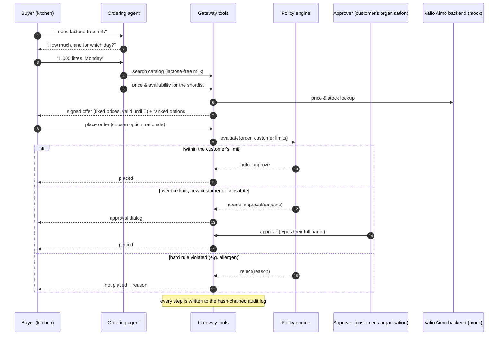

# Aimo Agent Gateway *(working title)*

> **Junction 2026 · Valio Aimo challenge.** Our goal is to let a professional kitchen order from a food-service wholesaler by talking to an AI agent: it asks for what's missing, finds and compares products and places the order in minutes, while real systems, confidential data and people's authority stay protected.

📋 **Progress tracker: [PLAN.md](PLAN.md)** · 🔌 **API notes: [docs/mock-api-notes.md](docs/mock-api-notes.md)**

## Run the MVP locally

```bash
pip install -r requirements.txt
cp .env.example .env               # Windows: copy .env.example .env, then add the Valio API key (team chat)
python scripts/download_data.py    # ~90 MB of challenge data into data/valio/ (git-ignored)
python -m uvicorn gateway.app:app --reload --port 8000
```

Open <http://127.0.0.1:8000>. The API docs are at <http://127.0.0.1:8000/docs>. The first start builds a slim catalog index, which takes a few seconds.

The site opens on a buyer-focused landing page where buyers sign in. Locally, with no `BUYER_PASSWORD` in `.env`, signing in needs no password.

| Page | What it shows |
|---|---|
| **Order** | Talk to the ordering agent in plain words (English, Finnish or Swedish; typed or spoken). It asks for anything missing, checks live prices and stock, and shows ranked options with its recommendation. You choose an option and click **Place order**; outside the agent's authority, a dialog asks a person to approve by typing their full name |
| **My orders** | Your orders: placed within the agent's authority, approved by a named person, or cancelled. A placed order can be cancelled until the order cut-off of its delivery |
| **Explore** | Search and filter aggregate product-group insights; product and supplier records, prices, customers and orders are not exposed |

Sign in as a buyer and use the example buttons on the Order page for the demo scenarios. Every step is still written to the hash-chained audit log in `data/runtime/audit.jsonl`.

**Deploying** to a Verda CPU instance takes one script: see [deploy/README.md](deploy/README.md).

---

## The problem

Today, professional kitchens order from Valio Aimo by logging into a webshop and clicking through a catalog. An AI agent can do most of that work: understand a need written in plain words, ask for what is missing, find and compare products, place the order and handle exceptions.

For that to work, the agent needs an interface through which it can:

1. **Look up** products, prices and availability in a structured way.
2. **Move from inquiry to a firm order** at fixed prices, with no negotiation.
3. **Stay inside its authority.** The agent decides some things on its own, and the rest goes to a person in the customer's organisation for sign-off.

All of this must work without exposing internal systems, confidential data or the marketplace roadmap. It should also be built on open, verifiable standards, so that the interface is not defined by someone else's platform.

## Our approach

We build an **ordering agent** into a **gateway** that Valio Aimo runs in front of its backend (the challenge provides a mock of it). Every customer talks to the agent in plain words, as a conversation: when the quantity, unit or delivery day is missing, the agent asks before it checks prices and stock. The agent never talks to the backend directly. It only uses a small, documented interface, and every order passes the same guardrails. The same interface is open to other clients, so a customer's own system or agent could use it later.

| # | Idea | What it gives |
|---|------|---------------|
| 1 | **One interface, two transports.** The tools the agent uses are offered as **REST/OpenAPI** today and as an **MCP server** next, so other clients get the same rules. | Open standards, no lock-in to one platform |
| 2 | **Signed offers that expire** *(trust protocol)*. Every price and availability answer is an offer with an `offer_id`, a validity window, its data source and timestamp, and a gateway signature (Ed25519). An order points to an offer. | An agent can check claims without a manual step, and prices are fixed |
| 3 | **The agent's authority and a policy engine** *(guardrails)*. Each customer's agent may order up to a set total on its own; hard rules (such as allergens) always apply. Each order is checked and gets one of three results: `auto_approve` (the agent orders), `needs_approval` (a named person in the customer's organisation must approve) or `reject`. | Clear lines between what the agent decides alone and what a person signs off |
| 4 | **An audit trail people can read**. Every step (search, offer, decision, approval, order) is added to a log where each entry is chained to the previous one by its hash. Each entry includes the agent's stated reason. The log is shown as a timeline to the buyer and to Valio Aimo. | Traceability and explanations, and trust on both sides |

## Architecture

```
┌──────────────────────────────┐        ┌──────────────────────────────┐
│ Buyer (a kitchen)            │        │ Approver (same organisation) │
│ Buyer portal: chat   (ui/)   │        │ Approval dialog      (ui/)   │
└──────────────┬───────────────┘        └──────────────┬───────────────┘
               │ REST (buyer session)                  │ approved_by = full name
               ▼                                       ▼
┌──────────────────────────────────────────────────────────────────────┐
│ Aimo Agent Gateway, run by Valio Aimo                                │
│  agent/    ordering agent: understands, asks what's missing          │
│  gateway/  agent tools · catalog search · offers · orders            │
│  trust/    sign-in · policy engine · approvals · signing · audit     │
└──────────────────────────────┬───────────────────────────────────────┘
                               │ server-side API key (never leaves the gateway)
                               ▼
        Valio Aimo mock backend (catalog, prices, stock, lead times,
        certificates & sustainability labels) — provided by the challenge
```

### Core flow: from request to order

*Example conversation: "I need lactose-free milk." → agent: "How much, and for which day?" → "1,000 litres, Monday."*



## Agent interface (MVP: REST, OpenAPI at `/docs`)

The data models live in [contracts/models.py](contracts/models.py).

| Endpoint | Purpose |
|---|---|
| `GET /.well-known/aimo-agent-gateway.json` | Discovery for agents: flow, offer-signing public key, data boundary |
| `POST /api/session/login` | Sign in to the buyer portal (as one customer) |
| `POST /api/chat` | Talk to the ordering agent: a question while details are missing, then a **signed fixed-price offer** + policy preview |
| `POST /api/requests` | Natural-language need → parsed intent → catalog search → Valio price & availability → **signed fixed-price offer** + policy preview |
| `POST /api/offers/{id}/evaluate` | Preview the decision for a different selection (nothing is placed) |
| `POST /api/orders` | Commit an offer → `placed` / `rejected`, with every check explained; outside the agent's authority it needs `approved_by` (the approver's full name) |
| `GET /api/catalog/search`, `POST /api/catalog/quote` | Explore static data; live price and stock only for hand-picked products |
| `POST /api/orders/{id}/cancel` | Cancel a placed order (optional reason) until the order cut-off of its delivery |
| `GET /api/customers` | The signed-in customer's own record |

Next step: expose the same operations as **MCP tools**, so other clients and agents can call them directly.

## Guardrails model (implemented in [trust/policy.py](trust/policy.py))

| Situation | Decision |
|---|---|
| Customer on the whitelist, total within its auto-approval limit, everything available on time and matching the request | ✅ Placed automatically |
| New customer (not on the whitelist) | 🧑 A named person approves |
| Total above the agent's limit, or more than 3× the customer's average order | 🧑 A named person approves |
| Not enough stock, a later delivery date, or the order cut-off has passed | ⛔ Revise the quantity/date and request a new offer |
| Substitute outside preferences | 🧑 A named person approves only when substitution is permitted; requested allergen exclusions remain hard rules |
| Missing explicit evidence for a requested or strict allergen exclusion | ⛔ Blocked until evidence is obtained and a new offer is evaluated |
| Product contains or may contain an allergen the customer never accepts | ⛔ Excluded / rejected (hard rule) |
| Offer expired or signature mismatch | ⛔ Rejected, including when approval is attempted |

## What stays private

The gateway exposes only selected data. It never exposes purchase prices, margins, supplier terms, other customers' data or the internal roadmap. The backend API key stays on the server. Buyers sign in per company and see only their own orders; the server checks this on every call. Approval is a deliberate double-check (the approver types their full name, which is recorded), not yet an authenticated approver account. Per-user accounts and scoped, revocable agent credentials are the next steps.

## Repository layout

```
.
├── contracts/   shared data models & vocabulary  (everyone, changes via PR)
├── gateway/     FastAPI app, catalog search, Valio API client, offer planner, orders   — Member A
├── trust/       whitelist, policy engine, signing, hash-chained audit log               — Member B
├── agent/       ordering agent: understands requests, asks follow-up questions          — Member C
├── ui/          web UI: plain HTML/CSS/JS, no build step                                — Member C
├── scripts/     download_data.py
├── docs/        mock-API notes, decisions, pitch material
└── data/        challenge datasets + runtime state (git-ignored)
```

## Tech stack (MVP)

- **Backend:** Python 3.12, FastAPI, Pydantic v2. The models in `contracts/` also give us the OpenAPI spec.
- **Storage:** JSON files in `data/runtime/` (to be replaced by SQLite).
- **Trust:** Ed25519-signed offers (the `cryptography` package), public key at `/.well-known/`, and a SHA-256 hash-chained audit log.
- **Ordering agent:** Claude (model from `CLAUDE_MODEL`; the demo uses `claude-haiku-5-5`, with structured outputs) reads the conversation and phrases follow-up questions in the buyer's language. Whether a question is needed is decided in code ([agent/dialogue.py](agent/dialogue.py)). Without `ANTHROPIC_API_KEY`, a rule-based parser (English + basic Finnish) does the same and always works.
- **UI:** vanilla JS modules, no build step. Colours follow the Valio Aimo portal theme.
- **Next:** an MCP server over the same operations, SQLite, and a PRH/YTJ business-ID lookup.

## Getting started

```bash
git clone https://github.com/Dadaist-chn/Junction2026.git   # into a folder outside OneDrive/Dropbox
cd Junction2026
```

Then follow [Run the MVP locally](#run-the-mvp-locally) above. Each module's folder has a README listing its files.

## Team

| Member | Role | Owns |
|---|---|---|
| A: _name_ | Gateway & data | `gateway/`, `contracts/` (coordinator) |
| B: _name_ | Trust & guardrails | `trust/` |
| C: _name_ | Agent & experience | `agent/`, `ui/`, demo |

## Challenge resources

- Resource portal: <https://junction26.valioaimo.fi/>. It has the datasets, API docs and mock backend access. The password and API key are in the team chat and in your local `.env`, **never in this repo**.
- All provided data is synthetic. No production systems or confidential data are involved.

## Regression checks

```bash
python -m unittest discover -s tests -v
```

Tests use synthetic fixtures and temporary storage, without API keys or live ordering. They cover budget and substitution parsing, allergen exclusions, approval revalidation, candidate relevance, packaging conversion and customer-separated API caches.

Editing a request invalidates its current quote; re-run before submitting. A stated budget is a hard EUR limit excluding VAT, separate from the customer auto-approval limit. Missing dates or units require confirmation. Insufficient stock or a late delivery cannot be approved as if the original request were fulfilled: revise the request and get a new quote. Approvals recheck the signed offer and hard rules; stock remains a snapshot from the mock API, without a reservation guarantee.
