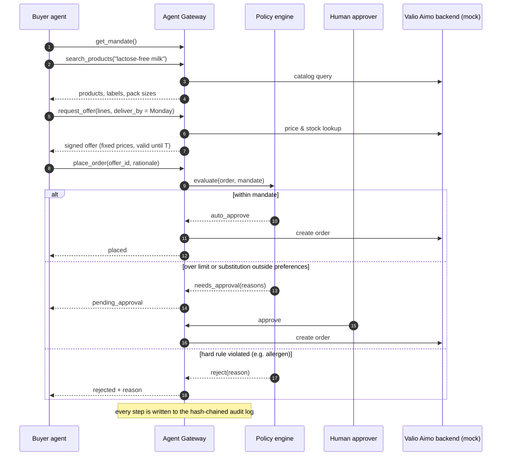

# Aimo Agent Gateway *(working title)*

> **Junction 2026 · Valio Aimo challenge.** Our goal is to let autonomous purchasing agents find products, compare offers and place orders with a food-service wholesaler in minutes, while keeping real systems, confidential data and humans' authority protected.

📋 **Progress tracker: [PLAN.md](PLAN.md)**

---

## The problem

Today, professional kitchens order from Valio Aimo by logging into a webshop and clicking through a catalog. Soon the buyer's own AI agent will do that work. It will find products, compare them, order them and handle exceptions on the buyer's behalf.

For that to work, Valio Aimo needs an interface that an external agent can use to:

1. **Look up** products, prices and availability in a structured way.
2. **Move from inquiry to a firm order** at fixed prices, with no negotiation.
3. **Stay inside its authority.** The agent decides some things on its own, and the rest goes to a human for sign-off.

All of this must work without exposing internal systems, confidential data or the marketplace roadmap. It should also be built on open, verifiable standards, so that the interface is not defined by someone else's platform.

## Our approach

We build a **gateway** between external purchasing agents and Valio Aimo's backend (the challenge provides a mock of it). Agents never talk to the backend directly. They only use a small interface that is documented and that they can verify.

| # | Idea | What it gives |
|---|------|---------------|
| 1 | **One agent interface, two transports.** The same set of tools is offered as an **MCP server** (for LLM agents) and as **REST/OpenAPI** (for any other client). | Open standards, no lock-in to one platform |
| 2 | **Signed offers that expire** *(trust protocol)*. Every price and availability answer is an offer with an `offer_id`, a validity window, its data source and timestamp, and a Valio Aimo signature (Ed25519). An order points to an offer. | An agent can check claims without a manual step, and prices are fixed |
| 3 | **Mandates and a policy engine** *(guardrails)*. The buyer organisation gives each agent a mandate a machine can read: spend limits, allowed categories, required labels, allergen rules and how far substitutes may differ. Each order is checked against it and gets one of three results: `auto_approve`, `needs_approval` (with reasons) or `reject`. | Clear lines between what the agent decides alone and what a human signs off |
| 4 | **An audit trail people can read**. Every step (search, offer, decision, approval, order) is added to a log where each entry is chained to the previous one by its hash. Each entry includes the agent's stated reason. The log is shown as a timeline to the buyer and to Valio Aimo. | Traceability and explanations, and trust on both sides |

## Architecture

```
┌──────────────────────────────┐        ┌──────────────────────────────┐
│ Buyer's purchasing agent     │        │ Human approver (buyer side)  │
│ LLM + tools        (agent/)  │        │ Approval & audit UI   (ui/)  │
└──────────────┬───────────────┘        └──────────────┬───────────────┘
               │ MCP / REST + agent credential         │ REST
               ▼                                       ▼
┌──────────────────────────────────────────────────────────────────────┐
│ Aimo Agent Gateway                                                   │
│  gateway/  agent interface · catalog search · offers · orders        │
│  trust/    mandates · policy engine · approvals · signing · audit    │
└──────────────────────────────┬───────────────────────────────────────┘
                               │ server-side API key (never exposed to agents)
                               ▼
        Valio Aimo mock backend (catalog, prices, stock, lead times,
        certificates & sustainability labels) — provided by the challenge
```

### Core flow: from request to order

*Example request: "I need 1,000 litres of lactose-free milk by Monday. Find an option that meets our requirements based on price and availability."*



## Agent interface (draft)

The source of truth is [contracts/](contracts/). This table is the starting point.

| Tool (MCP) / endpoint (REST) | Purpose | Scope |
|---|---|---|
| `get_mandate` | Shows what this agent may do, so it can plan within its limits | Core |
| `search_products` | Text search plus filters (category, labels, allergens, pack size) | Core |
| `get_product` | Product details, certificates, allergens, lead time | Core |
| `request_offer` | Price and availability for given lines and a delivery date. Returns a **signed fixed-price offer** valid until a set time | Core |
| `place_order` | Commits an offer. Returns `placed`, `pending_approval` or `rejected`, with reasons | Core |
| `get_order_status` | Status of an order or approval | Core |
| `suggest_substitutes` | Good, better and best alternatives within the assortment when the request can't be fully met | Optional |
| `compare_options` | Delivery reliability and sustainability labels alongside price | Optional |
| `get_audit_trail` | Readable log of what the agent did and why | Optional |

## Guardrails model (draft)

| Situation | Decision |
|---|---|
| Order total within the auto limit, and all items match preferences | ✅ Agent decides alone |
| Total above the auto limit, or weekly budget exceeded | 🧑 Human approval |
| Substitute outside stated preferences (label, brand, pack size, price change) | 🧑 Human approval |
| Delivery later than the requested date, or only part of the quantity available | 🧑 Human approval |
| Allergen or dietary rule violated (e.g. school or hospital kitchen) | ⛔ Rejected (hard rule) |
| Offer expired or signature invalid | ⛔ Rejected |

## What stays private

The gateway exposes only selected data. It never exposes purchase prices, margins, supplier terms, other customers' data or the internal roadmap. The backend API key stays on the server. Each agent signs in with its own credential, which can be limited in scope and revoked.

## Repository layout

```
.
├── contracts/   shared data models & interface spec  (everyone, changes via PR)
├── gateway/     agent interface, mock-backend client, offers, orders   — Member A
├── trust/       mandates, policy engine, approvals, signing, audit     — Member B
├── agent/       demo buyer agent + scenarios                           — Member C
├── ui/          approval & audit dashboard                             — Member C
├── docs/        mock-API notes, decisions, pitch material
└── data/        local copies of challenge datasets (git-ignored)
```

## Tech stack (proposed, to confirm at kickoff)

- **Backend:** Python 3.12, FastAPI, Pydantic v2. The models in `contracts/` also give us the OpenAPI spec.
- **Agent interface:** MCP Python SDK exposes the same tools as the REST API.
- **Storage:** SQLite for offers, orders, approvals and the audit log.
- **Trust:** Ed25519 signatures (the `cryptography` package) and a public key at `/.well-known/`.
- **Demo buyer agent:** Anthropic Python SDK with tool use, model `claude-opus-5-5`.
- **UI:** React + Vite, or Streamlit if time is short.

## Getting started

```bash
git clone <repo-url>
cd <repo>
cp .env.example .env     # fill in the keys (shared in team chat, never commit them)
```

Setup for each module is in that folder's README. Run commands will be added when the code lands.

## Team

| Member | Role | Owns |
|---|---|---|
| A: _name_ | Gateway & data | `gateway/`, `contracts/` (coordinator) |
| B: _name_ | Trust & guardrails | `trust/` |
| C: _name_ | Agent & experience | `agent/`, `ui/`, demo |

## Challenge resources

- Resource portal: <https://junction26.valioaimo.fi/>. It has the datasets, API docs and mock backend access. The password and API key are in the team chat and in your local `.env`, **never in this repo**.
- All provided data is synthetic. No production systems or confidential data are involved.
